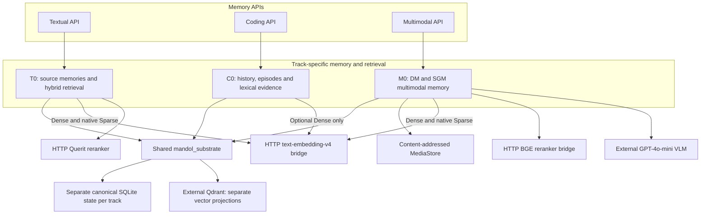

# Mandol Competition

[English](README.md) | [简体中文](README.zh-CN.md)

Mandol Competition is a unified, self-hosted agent memory system for the
Agent Memory Leaderboard (AML), supporting Textual, Coding, and Multimodal
workloads through a shared durable storage and retrieval substrate.

## Overview

The project exposes three isolated Memory APIs: **Textual T0**, **Coding C0**, and
**Multimodal M0**. Each track uses its own memory representation and retrieval
policy while sharing persistence, vector publication, request replay, and
recovery mechanisms. Add stores memories; Search returns stored evidence rather
than generating a final answer.

The implementation builds on [Mandol](https://github.com/AgentCombo/Mandol).
The [frozen method](docs/method/Frozen-Pipelines.md) describes the competition
pipelines independently of upstream paper results and official AML scores.

## Key features

- **Three memory tracks:** separate APIs, SQLite roots, and Qdrant collections
  keep Textual, Coding, and Multimodal workloads isolated.
- **Durable operations:** canonical SQLite state, idempotent Add requests,
  checked vector publication, and reconciliation support restart and recovery.
- **Track-specific retrieval:** Textual and Multimodal combine lexical, Dense,
  and native Sparse retrieval; Coding combines lexical evidence with optional Dense.
- **Multimodal memory:** validated text/image input, VLM extraction, and a
  content-addressed MediaStore preserve source order and restore images in results.
- **External inference:** CPU HTTP clients and bridges connect to embedding,
  reranker, and VLM services without loading GPU models into the API environment.
- **Reproducible tests:** deterministic inference fixtures exercise real storage,
  HTTP contracts, isolation, failure handling, and recovery on disposable resources.

## Architecture



SQLite is the canonical memory store. Qdrant holds verified vector projections
and compact metadata; original images belong in MediaStore. Run one API worker
per track. The APIs use an external Qdrant server and do not manage its lifecycle.

## Three memory tracks

| Track | Representation and frozen retrieval | Durable Add condition | Search output |
|---|---|---|---|
| Textual T0 | Source/context memories; BM25 + v4 Dense/native Sparse, RRF60, Querit B1 | Checked vector publication | Up to 10 source/context records within 24,000 characters |
| Coding C0 | Raw history and engineering episodes; lexical + optional complete-frontier v4 Dense with Dot similarity | Canonical and lexical durability | Up to 8 evidence cards, 16,000 characters total, 1,200 per source |
| Multimodal M0 | DM + SGM; BM25 + v4 Dense/native Sparse, RRF60, BGE BF16 | Required post-prepare vector publication | Ordered source text/images within context and media budgets |

All tracks also respect the request's `top_k`. T0/M0 use 1024-dimensional
`text-embedding-v4` Dense vectors and provider-native Sparse vectors. The
historical `splade` field names refer to this Sparse lane; no SPLADE service is
needed. **C0 uses neither native Sparse nor a neural reranker.** Experimental
selectors and alternative ranking profiles are separate from T0/C0/M0.

## Quick start

Use Linux, Python **3.12** and [uv](https://docs.astral.sh/uv/). The commands below
select Python 3.12.13 and the checked-in dependency lock:

```bash
git clone https://github.com/astronaut2003/mandol-competition-opensource.git
cd mandol-competition-opensource
uv sync --frozen --python 3.12.13 --extra all --extra dev
uv pip install --python .venv/bin/python --no-deps -e services/inference
python3 deployment/cluster/frozen.py
.venv/bin/python -m pytest tests/common/test_neutral_contracts.py tests/common/test_retrieval_primitives.py -q
```

This installs the application, its local substrate package, and CPU HTTP bridges.
It does not install GPU model servers or download weights. A track-only install
can use `--extra textual`, `--extra code`, or `--extra multimodal` instead of
`--extra all`. The full test suite uses all three extras and `--extra dev`.

To run the APIs, follow [Local deployment](docs/deployment/Local-Reproduction.md):
start Qdrant **1.19.1**, configure your inference services, and create local copies
of the deployment and serving templates. Then start each track in its own terminal:

```bash
.venv/bin/python scripts/start_api.py textual --config configs/local/deployment.toml
.venv/bin/python scripts/start_api.py code --config configs/local/deployment.toml
.venv/bin/python scripts/start_api.py multimodal --config configs/local/deployment.toml
```

Default ports are **18600**, **18601**, and **18602**, bound to loopback.

## Configuration and model serving

Use [frozen-bf16.example.toml](configs/deployment/frozen-bf16.example.toml) for
storage and endpoint configuration, and
[serving-bindings.example.json](configs/deployment/serving-bindings.example.json)
for model roots, aliases, revisions, serving versions, and dtype identities.
TOML does not expand shell variables. Supported environment overrides take
precedence; see the [deployment guide](docs/deployment/Local-Reproduction.md).

Required inference capabilities are paired v4 Dense/native Sparse, Querit for T0,
BGE for M0, and GPT-4o-mini for M0 extraction. C0's Dense channel is optional and
can degrade to lexical retrieval. The frozen reranker recipes use **BF16**;
different models, revisions, prompts, or precision settings are different methods.
See [Inference deployment](docs/deployment/Inference.md) for exact contracts.

Supply `MANDOL_MEMORY_SYSTEM_KEY`, `DASHSCOPE_API_KEY`, and `CLOSEAI_API_KEY` through
your environment or supported secret mounts. [.env.example](.env.example) lists
variable names; it is not loaded automatically. Set your own authorized
`MANDOL_MULTIMODAL_VLM_ENDPOINT`; the template's `example.invalid` URL is a
placeholder. Keep Qdrant and inference endpoints private and use HTTPS for remote
API access. See [Security](SECURITY.md).

## API usage

Use the track's port with `GET /health`, `POST /add`, and `POST /search`.
Authenticated calls accept `Authorization: Bearer`, `Authorization: Token`, or
`X-Api-Key`. With your Memory System Key already exported:

```bash
curl -sS http://127.0.0.1:18600/health
curl -sS http://127.0.0.1:18600/add \
  -H "Authorization: Bearer ${MANDOL_MEMORY_SYSTEM_KEY}" \
  -H 'Content-Type: application/json' \
  -d '{"request_id":"example-1","user_id":"example-user","session_id":"session-1","messages":[{"role":"user","content":"I prefer coffee without sugar."}]}'
curl -sS http://127.0.0.1:18600/search \
  -H "Authorization: Bearer ${MANDOL_MEMORY_SYSTEM_KEY}" \
  -H 'Content-Type: application/json' \
  -d '{"query":"What is my coffee preference?","user_id":"example-user","top_k":100}'
```

Add success echoes the request, user, and session IDs. Repeating the same request
ID and canonical payload replays one logical result; changed content conflicts.
Search returns `{"data": [...]}`, possibly empty. Results are isolated by user
across sessions and physically separated across tracks. Multimodal input and
results support ordered text/image parts. See [API reference](docs/API.md) for
schemas, response examples, media limits, and readiness endpoints.

## Testing and reproduction

The Quick Start tests need no model credentials. For the complete storage and
HTTP regression suite, use a new disposable Qdrant server:

```bash
docker run -d --name mandol-opensource-tests \
  --label mandol.test=opensource \
  -p 127.0.0.1:19633:6333 qdrant/qdrant:v1.19.1
.venv/bin/python scripts/run_tests.py \
  --qdrant http://127.0.0.1:19633 --container mandol-opensource-tests
```

The controller checks container ownership and emptiness, removes ambient model
configuration, and runs deterministic inference fixtures against real SQLite,
Qdrant, and HTTP APIs. Use disposable storage; these tests are not real-model
E2E measurements or official AML scores. [Reproduction](docs/Reproduction.md)
explains real-model opt-ins, optional local QA with pinned upstream evaluator
sources, and the distinction between compatibility tests and leaderboard results.

## Project structure

```text
src/mandol_competition/  # Track adapters, API runtime and model clients
packages/substrate/     # Shared SQLite, publication, retrieval and Qdrant mechanisms
services/inference/     # CPU HTTP bridges and optional model-worker adapters
configs/                # Frozen method artifacts and deployment templates
deployment/cluster/     # Frozen integrity checks and local evidence helpers
scripts/                # API launcher, isolated tests and explicit source retrieval
tests/                  # Contract, storage, failure, recovery and synthetic API tests
docs/                   # Method, deployment, API, reproduction and attribution
```

## Documentation

- [Frozen T0/C0/M0 pipelines](docs/method/Frozen-Pipelines.md)
- [Local deployment and troubleshooting](docs/deployment/Local-Reproduction.md)
- [Inference contracts and serving recipes](docs/deployment/Inference.md)
- [API reference](docs/API.md)
- [Tests and reproduction](docs/Reproduction.md)
- [Attribution](docs/ATTRIBUTION.md) and [dependency licenses](docs/Dependency-Licenses.md)
- [Security](SECURITY.md) and [contributing](CONTRIBUTING.md)

## License and attribution

Mandol Competition is distributed under [Apache-2.0](LICENSE), including its
unified competition implementation. Original Mandol copyright and attribution
are preserved in [NOTICE](NOTICE) and [Attribution](docs/ATTRIBUTION.md).
External dependencies, models, services, datasets, and separately retrieved
evaluation sources retain their own terms. Model weights and datasets are not
distributed with this project.

For the original Mandol design, cite
[Mandol: An Agglomerative Agent Memory System for Long-Term Conversations](https://arxiv.org/abs/2606.29778)
by Yuhan Zhang, Zhiyuan Guo, Ziheng Zeng, Wei Wang, Wentao Wu, and Lijie Xu.
This repository documents the competition implementation; the paper's results
and official leaderboard results describe their respective evaluated versions.
