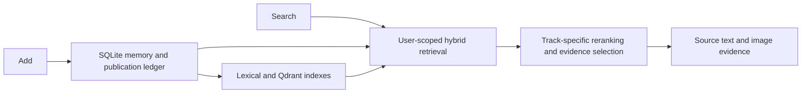

# Mandol Competition

[Mandol](https://github.com/AgentCombo/Mandol) · [Paper](https://arxiv.org/abs/2606.29778) · [Agent Memory Leaderboard](https://agentmemories.ai/)

[English](README.md) | [简体中文](README.zh-CN.md)

**This repository publishes Mandol’s AML implementations and versioned follow-up fixes.**

The current reproduction recipe is `mm-source-preserving-add-20261113-v3`. It adds bounded visual recovery and source-preserving Add. The earlier public M0 baseline remains at [`1be0776`](https://github.com/astronaut2003/mandol-competition-opensource/tree/1be077658277b020e528db42242cb7a146b9cc19). The new Add failure behavior is described in the [release notes](docs/releases/mm-source-preserving-add-20261113-v3.md).

Built on Mandol's memory organization and retrieval design, this implementation
provides persistent memory services for conversations, engineering history, and
text/image interactions. Agents write information through `Add` and retrieve
relevant source evidence through `Search`.

## Features

- **Three memory tracks.** Store conversational turns, repository work history,
  and ordered text/image messages through a common Add/Search interface.
- **Hybrid retrieval.** Combine lexical, Dense, and native Sparse retrieval with
  track-specific ranking and context assembly.
- **Source-aware results.** Return memory IDs, original text, session context,
  and image evidence for downstream answer generation.
- **Durable writes and replay.** SQLite state and a publication ledger coordinate
  Qdrant projections; repeated request IDs replay the same logical write.
- **User and track isolation.** Separate namespaces, storage roots, and vector
  collections keep each track's memories scoped to the requested user.
- **Recoverable inference.** Token-budgeted inputs, bounded retries, and visual
  extraction checkpoints support long requests and interrupted operations.

## Memory tracks

| Track | Input | Retrieval and evidence |
|---|---|---|
| **Textual · T0** | Conversations and cross-session history | Source/context retrieval, hybrid recall, Qwen reranking, and observation-order annotations. |
| **Coding · C0** | Engineering sessions and repository experience | Canonical history and episodes, lexical/native-Sparse/Dense retrieval, RRF fusion, and optional episode reranking. |
| **Multimodal · M0** | Ordered text and original images | Scene/OCR extraction, hybrid retrieval, evidence review, and attributed text/image delivery. |

Multimodal Search uses `source-grounded-recall-v4`. Positive or incomplete review
preserves candidate IDs, order, and scores. An empty result requires two complete
evidence-review passes. Relevant source context and original media retain their
own attribution. See the [method workflow](docs/method/Current-Workflow.md).

## Architecture



`mandol_substrate` handles canonical state, request identity, publication, and
recovery. Track adapters implement memory representation and retrieval policy.
Multimodal originals are held in MediaStore and referenced by memory records.

The default model configuration is:

| Component | Model |
|---|---|
| Embedding | `text-embedding-v4` with paired Dense/native Sparse output |
| Reranking | `qwen3.7-text-rerank` |
| Visual extraction and evidence selection | `gpt-4o-mini` |

The API processes and embedding bridge run on CPU; inference is provided by
the configured model services. Model interfaces and input budgets are described
in [Inference](docs/deployment/Inference.md).

## Installation

Requirements: **Linux, Python 3.12, uv, and Qdrant 1.19.1**. Docker can provide
the Qdrant service.

```bash
git clone https://github.com/astronaut2003/mandol-competition-opensource.git
cd mandol-competition-opensource
uv sync --frozen --python 3.12.13 --extra all --extra dev
uv pip install --python .venv/bin/python --no-deps -e services/inference

mkdir -p configs/local
cp configs/deployment/current-cloud.example.toml configs/local/deployment.toml
```

Configure the model endpoints in `configs/local/deployment.toml` and the
environment variables listed in [.env.example](.env.example):

| Variable | Purpose |
|---|---|
| `MANDOL_MEMORY_SYSTEM_KEY` | Authenticate Memory API requests |
| `DASHSCOPE_API_KEY` | Embedding bridge and Qwen reranking |
| `CLOSEAI_API_KEY` | Default VLM credential variable; configurable through `MANDOL_MM_VLM_API_KEY_ENV` |

Follow [Local deployment](docs/deployment/Local-Reproduction.md) to start Qdrant,
configure the VLM endpoint, and set shared provider limits.

## Run the services

Start the embedding bridge:

```bash
.venv/bin/python -m uvicorn mandol_inference.dashscope_bridge:create_app \
  --factory --host 127.0.0.1 --port 18620 --workers 1 --no-access-log
```

Start each API in a separate terminal:

```bash
.venv/bin/python scripts/start_api.py textual --config configs/local/deployment.toml
.venv/bin/python scripts/start_api.py code --config configs/local/deployment.toml
.venv/bin/python scripts/start_api.py multimodal --config configs/local/deployment.toml --initialize
```

Use `--initialize` only for the first Multimodal start on fresh storage. It
refuses an existing database; omit the flag on subsequent starts.

The default API ports are **18600**, **18601**, and **18602**. Each track uses one
worker, with 8 active and 8 waiting operations. The launcher checks the selected
method artifacts before startup.

## Add and search

With the Textual API running and `MANDOL_MEMORY_SYSTEM_KEY` set:

```bash
curl -sS http://127.0.0.1:18600/add \
  -H "Authorization: Bearer ${MANDOL_MEMORY_SYSTEM_KEY}" \
  -H 'Content-Type: application/json' \
  -d '{"request_id":"demo-1","user_id":"demo-user","session_id":"project-notes","messages":[{"role":"user","content":"The service uses PostgreSQL 16."}]}'

curl -sS http://127.0.0.1:18600/search \
  -H "Authorization: Bearer ${MANDOL_MEMORY_SYSTEM_KEY}" \
  -H 'Content-Type: application/json' \
  -d '{"query":"Which database does the service use?","user_id":"demo-user","top_k":100}'
```

Search returns `{"data": [...]}` with memory IDs, content, and ranking scores.
Coding and Multimodal use the same endpoint paths on their own ports. The
[API reference](docs/API.md) covers image inputs, options, replay, and errors.

## Tests and reproduction

Check the method artifacts and run a short local regression:

```bash
.venv/bin/python deployment/cluster/frozen.py
.venv/bin/python -m pytest tests/common/test_neutral_contracts.py \
  tests/common/test_retrieval_primitives.py -q
```

The full regression suite covers SQLite/Qdrant publication, HTTP contracts,
ranking, isolation, and recovery with deterministic inference fixtures. See
[Testing and reproduction](docs/Reproduction.md) for the isolated test runner
and model-backed integration tests.

## Documentation and license

| Guide | Contents |
|---|---|
| [Method workflow](docs/method/Current-Workflow.md) | Track policies, visual extraction, evidence review, and score fusion |
| [Local deployment](docs/deployment/Local-Reproduction.md) | Services, configuration, storage, and provider admission |
| [Inference](docs/deployment/Inference.md) | Model contracts, token budgets, and recovery |
| [API reference](docs/API.md) | Requests, responses, authentication, and replay |
| [Method artifacts](docs/method/Frozen-Pipelines.md) | Versioned selections and source integrity |
| [Testing and reproduction](docs/Reproduction.md) | Regression and integration procedures |

Contributions are welcome; see [CONTRIBUTING.md](CONTRIBUTING.md). This project is
licensed under [Apache-2.0](LICENSE). Mandol's original attribution is preserved
in [NOTICE](NOTICE) and [Attribution](docs/ATTRIBUTION.md). Third-party components
retain their own terms; see [Dependency licenses](docs/Dependency-Licenses.md).

## AML evaluation and compliance

The submission follows the [AML competition rules](https://agentmemories.ai/competition/).
Its default configuration uses `text-embedding-v4` for embeddings and
`gpt-4o-mini` for LLM components, with `qwen3.7-text-rerank` for reranking, in line
with the academic model policy.

Formal competition tests use AML's Add/Search contract and official Smoke/Full
workflow. Mandol supplies user-scoped memory evidence; AML runs the unified
Answer, Eval, and result-review pipeline. Code, configuration, and the submitted
version identify the tested system. Official results are published by AML after
its review process.
