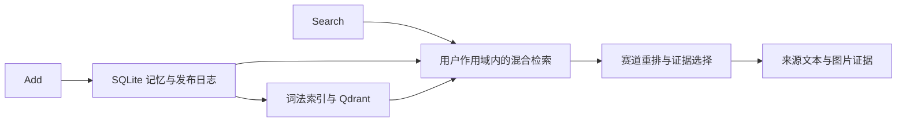

# Mandol Competition

[Mandol 原项目](https://github.com/AgentCombo/Mandol) · [原始论文](https://arxiv.org/abs/2606.29778) · [Agent Memory Leaderboard](https://agentmemories.ai/)

[English](README.md) | [简体中文](README.zh-CN.md)

**本仓库公开 Mandol 的 AML 三赛道实现，以及版本化的后续修复。**

当前复现版本为 `mm-source-preserving-add-20261113-v3`，包含多模态提取恢复与原始证据保留。原公开 M0 基线保留在提交 [`1be0776`](https://github.com/astronaut2003/mandol-competition-opensource/tree/1be077658277b020e528db42242cb7a146b9cc19)。新版本的 Add 失败处理与原版本不同，详见[版本说明](docs/releases/mm-source-preserving-add-20261113-v3.md)。

Mandol 面向需要长期记忆的智能体，研究记忆组织、语义结构与混合检索。本项目沿用其记忆组织与检索设计，提供面向对话历史、工程经验和图文交互的持久化记忆服务：通过 `Add` 写入信息，通过 `Search` 返回相关来源证据。

## 功能

- **三类记忆服务**：支持对话轮次、仓库工作历史，以及有序的文本和图片消息，使用统一的 Add/Search 接口。
- **混合检索**：结合词法、Dense、native Sparse 检索，按赛道完成排序与上下文组织。
- **来源可追溯**：返回记忆 ID、原始文本、会话上下文和图片证据，供后续回答使用。
- **持久化与请求重放**：SQLite 状态和发布日志协调 Qdrant 投影；重复请求复用同一次逻辑写入。
- **用户与赛道隔离**：使用独立的命名空间、存储目录和向量集合，按请求用户检索记忆。
- **推理恢复**：支持输入 Token 预算控制、有界重试和视觉提取检查点，处理长请求与中断后的恢复。

## 三个赛道

| 赛道 | 输入 | 检索与证据 |
|---|---|---|
| **文本 · T0** | 对话与跨会话历史 | 来源和上下文检索、混合召回、Qwen 重排、观测顺序标注。 |
| **代码 · C0** | 工程会话与仓库经验 | 原始历史和 episode，词法/native Sparse/Dense 检索、RRF 融合及可选的 episode 重排。 |
| **多模态 · M0** | 有序文本与原始图片 | 场景/OCR 提取、混合检索、证据审查，以及带来源的图文返回。 |

多模态 Search 使用 `source-grounded-recall-v4`。正向或不完整审查保留候选 ID、顺序和分数；返回空结果需要两轮完整证据审查。相关源上下文和原图保留各自的来源标注。详见[方法工作流](docs/method/Current-Workflow.md)。

## 架构



`mandol_substrate` 负责规范状态、请求身份、发布和恢复，赛道适配器负责记忆表示与检索策略。多模态原图保存在 MediaStore 中，由记忆记录引用。

默认模型配置如下：

| 组件 | 模型 |
|---|---|
| Embedding | `text-embedding-v4`，联合提供 Dense/native Sparse 输出 |
| Reranker | `qwen3.7-text-rerank` |
| 视觉提取与证据选择 | `gpt-4o-mini` |

API 和 Embedding Bridge 使用 CPU 运行，推理由配置的模型服务提供。模型接口和输入预算见[推理服务说明](docs/deployment/Inference.md)。

## 安装

环境要求：**Linux、Python 3.12、uv 和 Qdrant 1.19.1**。Qdrant 可通过 Docker 运行。

```bash
git clone https://github.com/astronaut2003/mandol-competition-opensource.git
cd mandol-competition-opensource
uv sync --frozen --python 3.12.13 --extra all --extra dev
uv pip install --python .venv/bin/python --no-deps -e services/inference

mkdir -p configs/local
cp configs/deployment/current-cloud.example.toml configs/local/deployment.toml
```

在 `configs/local/deployment.toml` 中设置模型服务地址，并按 [.env.example](.env.example) 配置环境变量：

| 变量 | 用途 |
|---|---|
| `MANDOL_MEMORY_SYSTEM_KEY` | 记忆 API 鉴权 |
| `DASHSCOPE_API_KEY` | Embedding Bridge 与 Qwen 重排 |
| `CLOSEAI_API_KEY` | 默认 VLM 凭据变量，可通过 `MANDOL_MM_VLM_API_KEY_ENV` 指定其他变量名 |

Qdrant 启动、VLM 地址配置和共享模型配额设置见[本地部署](docs/deployment/Local-Reproduction.md)。

## 启动服务

先启动 Embedding Bridge：

```bash
.venv/bin/python -m uvicorn mandol_inference.dashscope_bridge:create_app \
  --factory --host 127.0.0.1 --port 18620 --workers 1 --no-access-log
```

再在不同终端分别启动三个赛道：

```bash
.venv/bin/python scripts/start_api.py textual --config configs/local/deployment.toml
.venv/bin/python scripts/start_api.py code --config configs/local/deployment.toml
.venv/bin/python scripts/start_api.py multimodal --config configs/local/deployment.toml --initialize
```

`--initialize` 仅用于多模态首次空库初始化；已有数据库时会拒绝执行。后续启动去掉该参数，使用快速启动路径。

默认 API 端口依次为 **18600、18601、18602**。每赛道使用一个 worker，支持 8 个执行中请求和 8 个等待请求。启动器在启动前校验所选方法的配置和文件摘要。

## 写入与检索

启动文本 API 并设置 `MANDOL_MEMORY_SYSTEM_KEY` 后：

```bash
curl -sS http://127.0.0.1:18600/add \
  -H "Authorization: Bearer ${MANDOL_MEMORY_SYSTEM_KEY}" \
  -H 'Content-Type: application/json' \
  -d '{"request_id":"demo-1","user_id":"demo-user","session_id":"project-notes","messages":[{"role":"user","content":"The service uses PostgreSQL 16."}]}'

curl -sS http://127.0.0.1:18600/search \
  -H "Authorization: Bearer ${MANDOL_MEMORY_SYSTEM_KEY}" \
  -H 'Content-Type: application/json' \
  -d '{"query":"Which database does the service use?","user_id":"demo-user","top_k":100}'
```

Search 返回 `{"data": [...]}`，包含记忆 ID、内容与排序分数。代码和多模态服务在各自端口使用相同接口路径。图片输入、options、请求重放和错误语义见 [API 文档](docs/API.md)。

## 测试与复现

校验方法文件并运行一组本地回归：

```bash
.venv/bin/python deployment/cluster/frozen.py
.venv/bin/python -m pytest tests/common/test_neutral_contracts.py \
  tests/common/test_retrieval_primitives.py -q
```

完整回归使用确定性推理桩，覆盖 SQLite/Qdrant 发布、HTTP 协议、排序、隔离和恢复。隔离测试运行器及真实模型集成测试的使用方式见[测试与复现](docs/Reproduction.md)。

## 文档与许可证

| 文档 | 内容 |
|---|---|
| [方法工作流](docs/method/Current-Workflow.md) | 赛道策略、视觉提取、证据审查与分数融合 |
| [本地部署](docs/deployment/Local-Reproduction.md) | 服务、配置、存储与模型配额控制 |
| [推理服务](docs/deployment/Inference.md) | 模型协议、Token 预算与恢复 |
| [API 文档](docs/API.md) | 请求、响应、鉴权与重放 |
| [方法配置](docs/method/Frozen-Pipelines.md) | 版本化配置与源码完整性 |
| [测试与复现](docs/Reproduction.md) | 回归和集成测试 |

欢迎贡献代码，开发约定见 [CONTRIBUTING.md](CONTRIBUTING.md)。项目采用 [Apache-2.0](LICENSE) 许可证，Mandol 原项目的署名保留在 [NOTICE](NOTICE) 和[来源声明](docs/ATTRIBUTION.md)中。第三方组件遵循各自条款，见[依赖许可证](docs/Dependency-Licenses.md)。

## AML 比赛评测与合规

本系统按照 [AML 官方赛事规则](https://agentmemories.ai/competition/)组织正式参赛测试。默认配置使用 `text-embedding-v4` 完成 Embedding，使用 `gpt-4o-mini` 完成 LLM 相关处理，并使用 `qwen3.7-text-rerank` 重排，符合学术榜的模型使用要求。

正式比赛测试采用 AML 的 Add/Search 协议和官方 Smoke/Full 流程。本系统提供用户作用域内的记忆证据，由 AML 统一完成 Answer、Eval 和结果复核。参赛代码、配置与提交版本共同标识受测系统，正式成绩由 AML 完成复核后发布。
