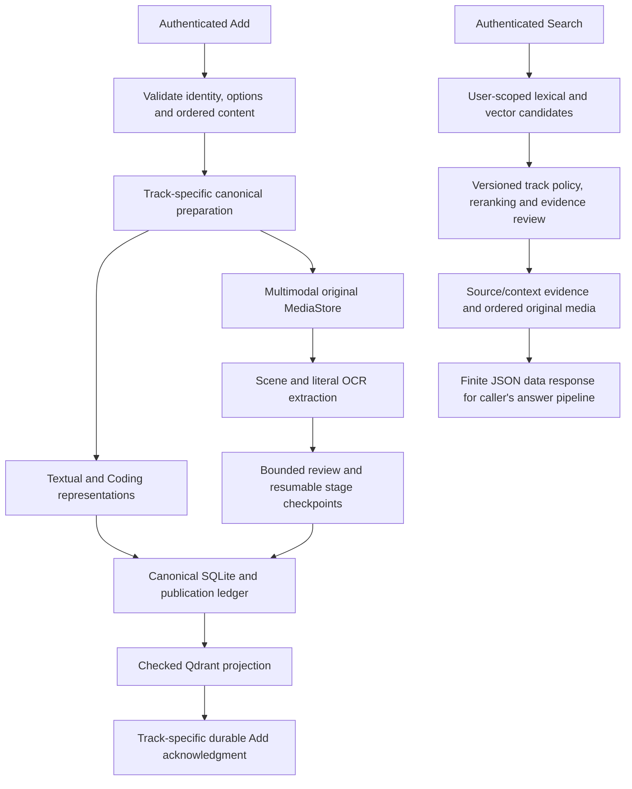

# Competition workflow

This document describes the `mm-source-preserving-add-20261113-v3` reproduction recipe,
including follow-up fixes to the T0/C0/M0 implementation. See the
[release notes](../releases/mm-source-preserving-add-20261113-v3.md) for its historical boundary.

## Track selections

| Track | Selection |
|---|---|
| Textual | `aml-official-eligible-v1`, `textual-t0-observation-history-v1`, `dashscope-qwen37-v1`. |
| Coding | `aml-official-eligible-v1`, `code-native-sparse-rrf100-v1`, `dashscope-qwen37-v1`. |
| Multimodal | `aml-official-eligible-v1`, `mm-qwen37-same-pool-rank-only-v1`, `source-grounded-recall-v4`, `retry-required-v1`. |

Textual retains source/context retrieval and adds the versioned observation-order
view. Coding's native Sparse/Dense retrieval and optional reranking have explicit
frontier and fallback rules. Multimodal keeps the same retrieval candidate pool
for its Qwen ranking policy and preserves original-image evidence bindings.
The versioned method artifacts define numerical policies, model bindings
and evidence formats for each track.

## Multimodal Add

1. Validate ordered text/image input and persist content-addressed original media.
2. Use `gpt-4o-mini`, prompt `multimodal_sgm_v3_ocr_lines`, and canonical schema `1`.
3. Separate visual scene fields from literal text when recovery is required.
   OCR lines retain actual reading order; image/context text is untrusted data.
4. Review suspicious repetition, incomplete output and uncertain readability.
   Recovery uses bounded, full-coverage image bands and typed validation.
5. Store stage checkpoints bound to image, context, model, prompt and schema.
   Replay can reuse completed validated stages without duplicating publication.
6. Publish canonical/lexical/vector state according to the track's durable Add
   rules. If bounded OCR recovery is exhausted after a scene was validated,
   retain the original image, source text, scene and validated OCR fragments.
   Mark OCR as incomplete and retain its receipt in the request ledger;
   incomplete OCR never enters the successful extraction cache.
7. If no trustworthy scene remains after confirmed content failures exhaust
   bounded recovery, the selected `MANDOL_MM_VISION_SOURCE_FALLBACK=1` policy
   publishes the durable original image/text and validated partial fields as
   `source_only`. It does not create a successful extraction cache entry.
8. Replay a completed request without another provider dispatch. Authentication,
   invalid input, unresolved transport outcomes and failed storage/publication
   remain errors. Source fallback applies to Add, never image-query extraction.
9. A failed whole-scene rescue can continue through bounded scene-field pages.
   Repetition guards stop looping scene output; actual repeated OCR text is
   preserved. A validated concise OCR recovery can select that prompt directly
   for later crops in the same bound input ledger.

The model's maximum output capacity is 16,384 tokens; the current configured
per-call output budget is 1,024. Those are different limits. The implementation
also bounds stage/crop counts, request time and paid/unknown outcomes. It does
not repeat arbitrary paid failures without a grant. Traditional OCR and image
label services are possible future methods, not enabled components of this one.

## Multimodal Search evidence review

The public launcher explicitly selects `source-grounded-recall-v4`. Historical
evidence policies remain available through their explicit configurations.

1. Preserve baseline result IDs, rank order and scores. Positive or incomplete
   review retains those results, including atomic and partial supporting facts.
2. For relational queries, obtain bounded original-source context within the
   same user's published view: at most 8 sources and 32 KiB of context text.
   Nearby messages and shared text anchors are hints, not proof of a relationship.
3. Review source fragments with overlap, including original media when available.
   Review is bounded to 256 fragments, 8 batches per pass, and 16 model calls.
4. An empty response requires two complete passes rejecting every planned
   fragment. Truncated input or an exhausted review budget preserves the baseline;
   malformed optional review preserves baseline results and marks review incomplete.
   Provider errors remain typed failures.
5. Deliver useful reviewed source context with its own attribution and prioritize
   useful original media under the existing response budget. Context does not
   consume another top_k slot or change stored canonical records.

The selector model remains `gpt-4o-mini`. These checks do not manufacture an
answer, calibrate rank scores as confidence, or establish that a source supports
an unobserved entity, event or relationship.

## Input length and score merging

- Embedding uses bundled Qwen3-Embedding tokenizer assets and content views of
  at most **8,000 tokens**, leaving space below the provider's 8,192-token limit.
  Overlong query views are combined by the implemented weighted Dense/Sparse
  fusion. The original query remains available to the other retrieval stages.
- Qwen reranking uses its bundled compatibility tokenizer and **29,800 query
  tokens**, **49,800 query characters**, **32,568 pair tokens**, and **119,800
  aggregate request tokens**. The request cost accounts for the query once per
  document, rather than once per HTTP request.
- A short rerank request preserves provider scores. Multiple views score the
  same document identities and merge via tie-aware normalized **RRF60**, rather
  than averaging request-relative relevance scores. A fused rank score is not
  a calibrated probability or answerability confidence.
- Known input-length rejections allow bounded replanning; arbitrary 400 errors,
  unknown paid outcomes, 429 and deadline errors are not treated as permission
  for unlimited retries. Partial view results do not become a complete ranking.

## Isolation and operational bounds

Use separate SQLite roots, MediaStores, namespaces and collections for each
track. Public startup selects one API worker per track, 8 executing plus 8
waiting operations, and 1,740-second Add/Search deadlines. Supply provider quota
windows through a local process-shared reliability configuration if needed.
Configure quota windows from the limits of the provider account.

The integrity manifest binds the selected methods to source and resource hashes. Begin reproduction with fresh storage. Historical
databases require their matching schema, identities and migration process.

The selected recipe disables periodic paid reranker health probes and recovers
on real requests after cooldown. Full MM database audits are opt-in; resource
bindings, publication-frontier checks and per-hit validation remain enabled.
